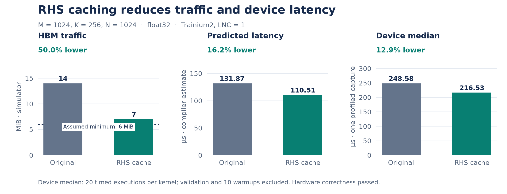
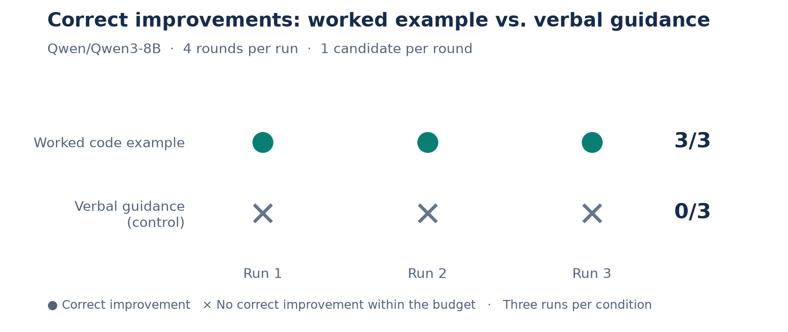
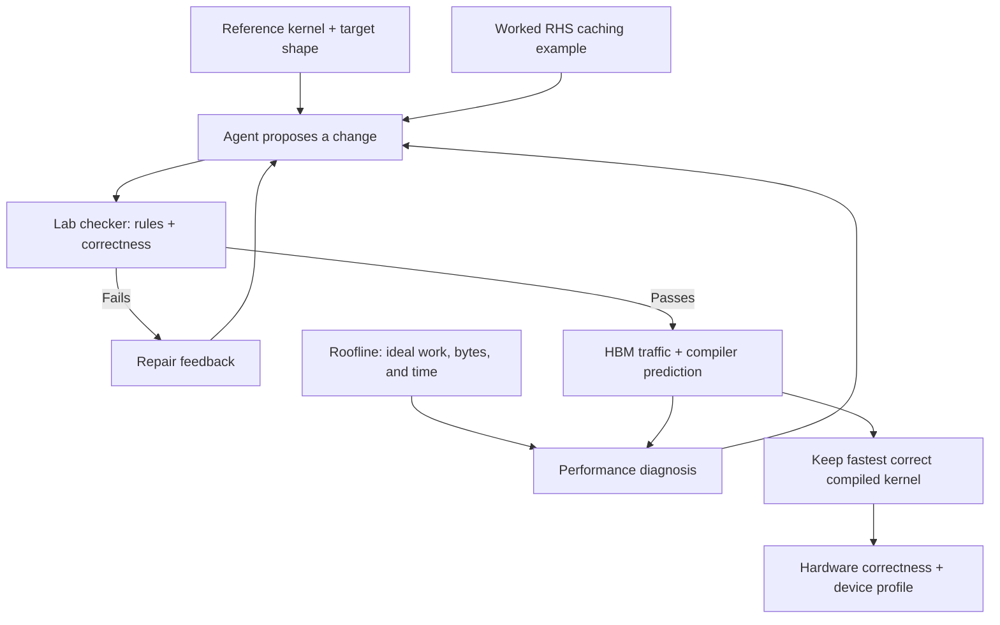
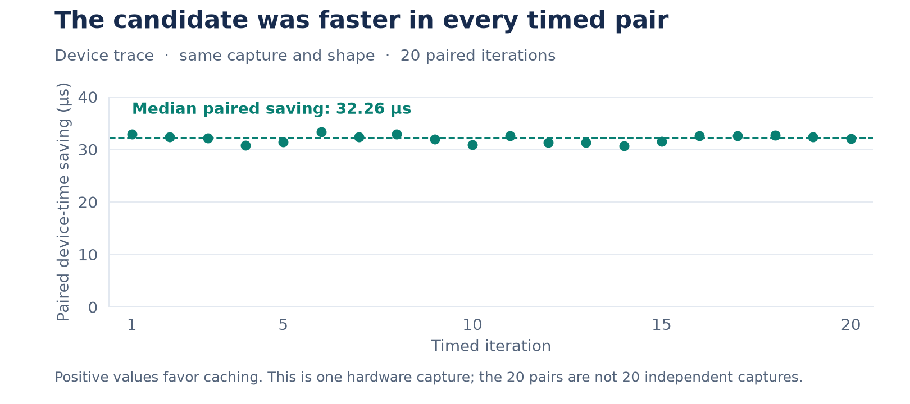

# Roofline-guided kernel optimization on AWS Trainium2

Experiments from the NYU × Annapurna Labs Hack the Chip event, October 10, 2026.
We connected a theoretical roofline tool to the kernel-agent project in
`trainium-agent-labs`, then tested whether a worked optimization example helped
Qwen/Qwen3-8B improve a matrix multiplication kernel.

**With the worked example, the agent found a correct improvement in 3/3 runs.
The control found none in 3 runs under the same four-round budget.** The generated
kernel halved HBM traffic and reduced profiled device median latency by **12.9%**
in one hardware capture on the target shape.

## Main results

Target operation: `C = A × B`, with `M=1024`, `K=256`, `N=1024`, float32 inputs and
outputs, compiled for Trainium2 with one physical NeuronCore (`LNC=1`). The kernel
receives the left operand already transposed as `lhsT[K, M]`.



| Metric | Original reference | Agent-generated RHS cache | Change |
|---|---:|---:|---:|
| Simulator HBM traffic | 14 MiB | 7 MiB | 50% less |
| Compiler-predicted latency | 131.872 µs | 110.512 µs | 16.2% lower |
| Profiled device median | 248.5775 µs | 216.534 µs | 12.9% lower |
| Hardware correctness at target shape | Passed | Passed | Preserved |

The candidate was faster in all 20 paired timed iterations in the target-shape
capture. Predicted latency and measured device time are different metrics; the
compiler did not precisely predict the hardware benefit.

The assumed minimum traffic at this shape is 6 MiB: read A once, read B once,
and write C once. The 7 MiB candidate still reloads some left-hand data and is
16.7% above that minimum.

## What changed in the kernel

The original kernel loops over output-row tiles (`m`), output-column tiles (`n`),
and contraction tiles (`k`). Its RHS load is inside all three loops, even though
the loaded RHS slice depends only on `n` and `k`. It reloads the same RHS data for
each output-row tile.

The successful kernel changes the ordering:

1. Select an output-column strip with `n`.
2. Load every RHS K tile into a distinct slice of an SBUF cache.
3. Iterate over all `m` tiles, reusing those cached RHS tiles.
4. Keep one PSUM accumulator per output tile, outside its K loop, and store the
   result after all K tiles have contributed.

The cache has shape `[128, K/128, 512]`. Separate storage for each K tile matters:
preloading several tiles into the same buffer would overwrite the earlier ones
and produce incorrect results. Moving buffer allocations alone also does not
remove HBM loads.

The [agent-generated winner](roofline/roofline_transfer_best.py) implements this
cache. The earlier [explicit cache experiment](roofline/matmul_rhs_cached.py) was
implemented directly by the assistant to validate the technique before using it
as a worked example in the agent's prompt.

## Agent experiment and control

Both conditions used Qwen/Qwen3-8B, the same correct reference seed, the same
target shape, four rounds, and one candidate per round. Each run started in a
fresh agent process. The example was validated at `M=512, K=256, N=1024`; the
target doubled M to 1024 while keeping K and N fixed.



| Outcome | With worked code example | Control without worked code example |
|---|---:|---:|
| Runs finding a correct, compiled improvement | 3/3 | 0/3 |
| Correct, compiled generated candidates | 12/12 | 0/12 |
| First improvement | Round 0 in every run | None within four rounds |
| Best retained kernel | Cached candidate | Original seed |

Success requires passing the four standard lab correctness shapes, additional
numerical and input-preservation checks at the target shape, successful
compilation, and a prediction faster than the seed. The preserved seed does not
count as a generated success. The standard `(M, K, N)` shapes were
`(128,128,512)`, `(256,256,1024)`, `(128,512,512)`, and `(512,256,1024)`.

The control retained the same verbal RHS-reuse guidance and roofline feedback;
it omitted only the worked code example. Its failures included using `k` before
definition, loading the wrong K tile, out-of-bounds slicing, and mismatched
source/destination tile sizes.

All three example-guided runs produced the same normalized Python syntax tree
for the winner. This shows reproducibility of this outcome, rather than broad
exploration of different optimizations.

## How the roofline and labs work together

The lab checker establishes correctness and counts HBM traffic. The compiler
predicts latency. The roofline estimates minimum work and traffic, identifies
the ideal limiting resource, and turns the gap into feedback for the agent.

The modified agent continues after finding a correct kernel, ranks correct
compiled candidates by predicted latency, logs every attempt, and preserves the
fastest valid candidate even if later revisions fail.



The tool reports two separate floors:

- **Hardware floor:** an ideal time estimate from documented resource peaks,
  assumed bandwidth sharing, and perfect overlap.
- **Compiler-model floor:** an idealized estimate using the rates charged by the
  installed compiler's prediction model, including its fixed cost.

These floors are diagnostic references, not measured runtimes. Their
assumptions and calibration are documented in the [roofline README](roofline/README.md).

## Hardware measurement

We used a `trn2.48xlarge` seat pod with NKI
`0.6.0+31049202112.g85070674`, neuronx-cc `2.27.5334.0+f702b353`, and runtime
`2.34.10`. The benchmark uses the installed standalone SDK's `compile_to_bir`
and `run_from_bir` execution path.

Both kernels were checked against the numerical reference on hardware before
timing. Each profile contains one validation execution, ten warmups, and twenty
timed executions per kernel. Timed execution order alternates between reference
first and candidate first.

The analysis excludes validation and warmups and uses `ExecutionInfo.parquet`
device start/end timestamps. The corresponding runtime `nc_exec_running`
durations agree within 1 ns. Model IDs distinguish the kernels after mapping
the initial reference-then-candidate execution order.



The prepared execution-call wall-time benchmark includes runtime and transfer
overhead. We used device traces to assess the kernel improvement rather than
comparing those wall times directly with the roofline.

An earlier explicit caching experiment at `M=512` reduced traffic from 7 MiB to
4 MiB. Two stable repeat captures measured device median reductions of 12.83%
and 12.74%. Its first capture had a timing shift affecting both kernels. These
results support the reuse mechanism but are not repeated hardware measurements
of the final `M=1024` agent-generated kernel.

## Reproduce the agent comparison

Prerequisites: a working lab pod with the Neuron SDK, the original Project 02
files, and a configured Qwen/Qwen3-8B endpoint. Put the roofline helpers under
`/workspace/projects/02-kernel-agent/roofline`, and deploy
`roofline/agent_remote.py` as `agent_roofline.py` in the project directory.

Run inside the pod:

```bash
cd /workspace/projects/02-kernel-agent
python agent_roofline.py --level 4 --optimize \
  --seed-kernel reference_level4.py \
  --benchmark-shape 1024 256 1024 \
  --reuse-example \
  --rounds 4 --samples 1 \
  --log example_trial.jsonl
```

Run the control with the same arguments, omit `--reuse-example`, and use a
different log filename. The [repeat script](roofline/repeat_agent_comparison.sh)
runs two additional trials per condition, reversing condition order for the
second pair. Use fresh log paths: the agent appends to existing logs.

## Reproduce hardware profiling

With the reference, generated winner, and benchmark script available in the pod:

```bash
env -u NEURON_RT_VISIBLE_CORES \
  NEURON_RT_NUM_CORES=1 \
  NEURON_LOGICAL_NC_CONFIG=1 \
  NEURON_RT_INSPECT_ENABLE=1 \
  NEURON_RT_INSPECT_DEVICE_PROFILE=session \
  NEURON_RT_INSPECT_OUTPUT_DIR="$PWD/roofline_profiles_transfer" \
  python roofline/benchmark_hardware.py \
    --reference reference_level4.py \
    --candidate roofline_transfer_best.py \
    --shape 1024 256 1024 \
    --warmup 10 --iters 20
```

Export the trace tables:

```bash
neuron-explorer view \
  -d roofline_profiles_transfer \
  --output-format parquet \
  --output-file roofline_decoded_transfer
```

This installed Explorer version keeps a server running after export. Press
Ctrl+C after it confirms the tables were saved. With PyArrow available, analyze
the export using:

```bash
python roofline/analyze_device_profiles.py roofline_decoded_transfer \
  --output device_transfer.json
```

## Evidence files

| File or directory | Contents |
|---|---|
| [Final agent comparison report](roofline/control_comparison_report.md) | Six-run results, methods, and interpretation |
| [Per-trial results](roofline/agent_comparison_results.json) | Success decisions, metrics, source paths, and normalized-code hashes |
| [Transfer report](roofline/transfer_report.md) | New-shape optimization and hardware results |
| [Initial example log](roofline/roofline_transfer.jsonl) | Seed and four generated attempts |
| [Initial control log](roofline/roofline_transfer_control.jsonl) | Control seed and four failed candidates |
| [Repeated agent trials](roofline/roofline_agent_repeats/) | Additional logs, terminal transcripts, and preserved winners |
| [Target device timing analysis](roofline/device_transfer.json) | Per-execution samples and medians |
| [Target profile tables](roofline/roofline_decoded_transfer/) | Decoded device and runtime traces |
| [Earlier cache report](roofline/device_cached_report.md) | Explicit caching experiment and repeat captures at M=512 |

The figures are generated from the saved logs and timing analysis by
[plot_findings.py](roofline/plot_findings.py). With Matplotlib and NumPy available,
run `python roofline/plot_findings.py` to regenerate the PNG and SVG assets under
`docs/figures/`.

## Limits of the findings

- Three runs per condition on one model and one target shape are a small
  experiment, not a general success-rate estimate.
- The worked example demonstrates close transfer: only M changes. This is
  in-context guidance, not permanent model training.
- The control isolates the worked code example, not roofline feedback versus
  no optimization guidance.
- The final agent-generated kernel has one hardware timing capture. Its
  repeatability across target-shape hardware captures remains untested.
- Profiling and shared-device conditions may affect absolute timing.
- The old lab checker's 222 FLOPs/byte ridge is for Trainium1 BF16; it should
  not be used as a quantitative ceiling for these Trainium2 float32 runs.

The supported finding is that **a concrete, validated caching example helped
this agent turn roofline feedback into a correct improvement, and device
profiling confirmed a performance benefit on the tested shape**.
